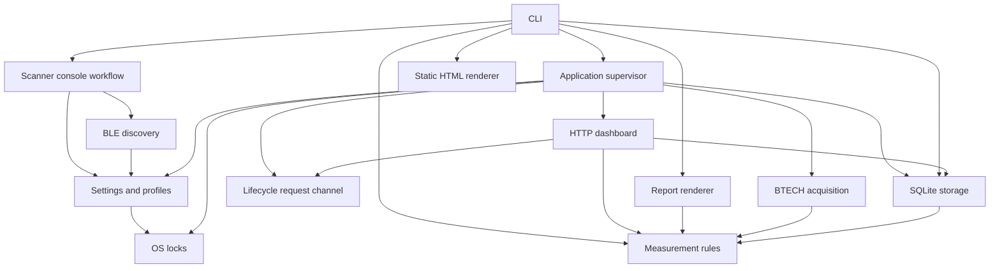

# Project architecture

GPS-RSSI is one Python package with separate command, configuration, acquisition,
persistence, measurement, and presentation responsibilities. Windows launchers
are convenience entry points into the same CLI. The refactoring keeps commands,
personal setup filenames, database schema, and measurement behavior unchanged.

## Responsibilities

| Module or directory | Owns |
|---|---|
| `cli.py` | Argument parsing, help, command dispatch, and command-level input/output |
| `scan_cli.py` | Candidate display, interactive selection, and scanner workflow messages |
| `settings.py` | Profile defaults, personal TOML loading/validation, setup hints, and backed-up setup edits |
| `locking.py` | Cross-platform OS file locks; no knowledge of radio or dashboard lifecycle |
| `app.py` | Composition and supervision of the collector and HTTP server; start/reset/exit lifecycle |
| `controls.py` | Thread-safe lifecycle requests, per-launch capabilities, operation status, and shutdown acknowledgement |
| `discovery.py` | Read-only BLE discovery and candidate classification; no prompts or configuration writes |
| `btech.py` | Read-only radio acquisition, polling, command timeouts, and reconnect handling |
| `ble.py` | The narrowly scoped cleanup adaptation for the pinned Benlink library |
| `storage.py` | SQLite recording, consistent read snapshots, CSV export, and transactional backup/reset |
| `measurements.py` | Pure timestamp, GPS-quality, and receive-point qualification rules |
| `analysis.py` | Report calculations and text presentation over already-loaded data |
| `mapping.py` | Standalone HTML presentation of already-qualified points |
| `live.py` | Loopback HTTP routes, incremental dashboard snapshots, and enqueueing authorized control requests |
| `profiles/` | Packaged mobile/fixed TOML defaults, including the supplied Bluetooth addresses |
| `assets/` | Browser HTML/JavaScript, licensed Leaflet resources, and the planning-area GeoJSON |

## Dependency direction

The supervisor is a consumer of shared services. Settings, locks, discovery,
storage, and measurement rules must not import it. Discovery can be imported
without loading SQLite, the HTTP server, or optional Bluetooth backends. Optional
libraries are imported when the corresponding operation is actually requested.
Architecture tests check isolated imports and first-party dependency cycles.

## Lifecycle and resource ownership

`app.start` resolves personal settings, owns the database instance lock and the
writer's `Store`, and constructs the selected services. `run_together` keeps
Bluetooth polling and SQLite writes on the main asyncio thread. The HTTP server
runs in a managed thread and opens its own short-lived read connections.

The HTTP layer never mutates recording tables or drives the radio directly.
Authorized POST requests enter the `Controls` queue. The supervisor cancels and
awaits the collector before reset or exit. `Store.reset` owns backup verification
and the database transaction. It leaves settings and database file identity
intact. Exit acknowledges only a completion response actually sent to the browser.

`record` and the combined launcher share `btech.collect`; there is one polling
implementation. Collection accepts a store and a connection factory rather than
creating a database or web server itself. The current composition uses BTECH;
another receiver adapter can be added without moving radio logic into the UI.

## Configuration and discovery

`profiles/uvpro.toml` and `profiles/uv50pro.toml` are bootstrap defaults, not live
user configuration or web assets. Personal files remain `uvpro.toml` and
`uv50pro.toml`, are Git-ignored, and take precedence over defaults. Existing files
are not rewritten by loading. Relative data paths remain relative to the setup
file. `settings.profile_template` is the single template-resource lookup.

`discovery.discover` returns candidate data and warnings. Advertised model names,
saved setup hints, and Bluetooth proximity measurements remain distinct from
verified hardware identity and RF-link RSSI. `scan_cli` decides how to present
that data and obtains an explicit selection. Only `settings.save_selection`
changes a setup file; it validates, backs up, and replaces it while preserving
unrelated fields and comments.

## Analysis and maps

`storage.load_log` owns read-only SQL and snapshot lifetime. Reports and HTTP
snapshots use it rather than maintaining separate database queries. CSV export
also lives in storage, with an explicitly closed connection.

`measurements` owns qualification rules shared by reports, static maps, and the
live dashboard. It compares GPS time with measurement time, retains original RSSI
units, and distinguishes receive direction. Storage input validation and GPS
qualification are separate: an observation can be worth recording without being
usable as a map point.

Static HTML and the live browser application have different presentation
lifecycles. Their rendering remains separate, while measurement eligibility is
shared. The planning overlay is display context and does not discard out-of-area
observations. Fixed-site uplink records still require pairing with mobile GPS
before they can be mapped.

## Scripts and packaging

Root launchers retain their existing names:

- `start-uvpro.cmd`: launch the mobile setup.
- `start-uv50pro.cmd`: launch the fixed setup.
- `scan-radios.cmd`: scan and select, leaving results visible.

They delegate virtual-environment lookup, checkout working directory, Python
invocation, and error handling to `scripts/run-gps-rssi.cmd`. The scanner wrapper
also pauses after a successful scan. Native Windows launcher verification remains
necessary; Python/HTTP tests run in Linux.

`scripts/build_area.py` is a maintenance tool, not a runtime dependency. Its GIS
packages are not imported by the application. Leaflet and planning data remain
packaged resources. Wheels must include `profiles/*.toml` and browser assets,
without old setup templates under `assets/`.

No scheduling, PTT automation, log pairing, RF calibration, or Kenwood adapter is
introduced by this refactor. Those capabilities should be added at the relevant
acquisition, measurement, and composition boundaries rather than in launch scripts.
